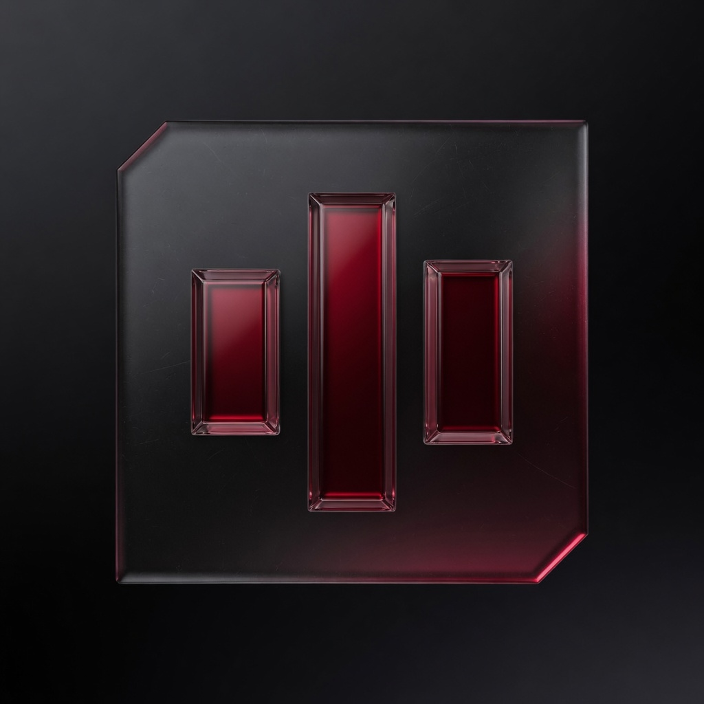

<p align="center">
  
</p>

<h1 align="center">Soundrix</h1>

<p align="center">
  A Windows soundboard for playing clips on your speakers, a virtual microphone, or both.
</p>

Soundrix keeps a library of audio files and plays them into the apps you already use. Voice chat keeps its real microphone. Soundrix plays into a virtual cable, and the chat app listens on the other end of that cable.

## Play a sound

| Control | What it does |
| --- | --- |
| Both | Plays on speakers and the microphone output. This is the default. |
| Speakers | Plays only on the selected speaker device. |
| Microphone | Plays only on the selected microphone output. |
| Play | Plays the row with the current mode. Double-click the name to do the same. |
| Speakers / Mic | Plays that row on one output, without changing the mode. |
| Stop | Stops every sound that is playing. |

A playing row is marked with a red edge. Sounds can overlap.

Each sound has a **Key** button. Click it, then press the shortcut. Function keys can stand alone. Any other key needs Ctrl, Alt, or Shift. Backspace clears the shortcut, and Escape cancels. The shortcut works while Soundrix is in the background and plays with the current mode.

## Microphone setup

Soundrix does not install a driver and does not write into a capture device. The microphone output is a playback device you choose, usually a virtual cable.

1. Install [VB-Audio Cable](https://vb-audio.com/Cable/).
2. Leave **Microphone** set to **Auto (VB-Cable)**. Soundrix selects the device whose name contains `CABLE Input`.
3. In Discord, or whichever app should hear the clip, set the microphone to **CABLE Output**.

`CABLE Input` is where Soundrix plays. `CABLE Output` is what the chat app records. If you pick `CABLE Output` as the microphone output inside Soundrix, the clip will not reach the chat app.

Without a virtual cable, **Speakers** still works. **Microphone** and **Both** explain what to install and which device to select.

## Library

Add files or a folder from the toolbar, or drop them on the window. Search by name, group sounds into categories, and collect them in playlists. The library is saved on this PC and restored the next time Soundrix opens.

Imported formats: AAC, FLAC, M4A, MP3, Ogg Vorbis, and WAV. Opus files can be imported, but playback may fail.

## Requirements

- Windows 10 or later
- [Node.js](https://nodejs.org/) 20 or later
- [Rust](https://www.rust-lang.org/tools/install) stable
- VB-Audio Cable, or another virtual cable, when a clip should be heard as a microphone

## Develop

```bash
npm install
npm run tauri dev
```

The window opens against the Vite dev server at `http://localhost:1420`.

```bash
npm run tauri build
```

Library model tests:

```bash
cargo test --manifest-path crates/soundrix-core/Cargo.toml
```

## Project layout

| Path | Contents |
| --- | --- |
| `src/` | React interface |
| `src-tauri/` | Tauri app, device playback, and file decoding |
| `crates/soundrix-core/` | Library model and mixer |
| `assets/soundrix-logo.png` | App mark |
